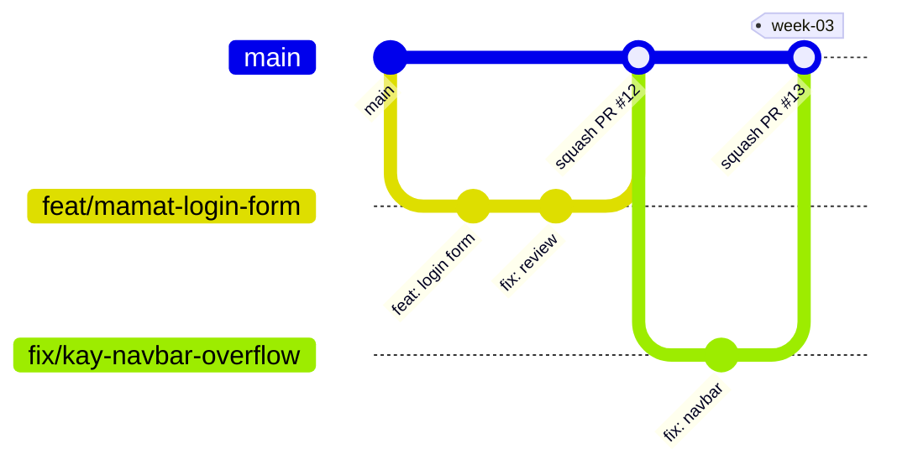

# Template SEMpoL Kel 7

**Software App** adalah source code frontend project mata kuliah Software Engineering, PPTI 25 Kelompok 7. Repo ini berisi template aplikasi sekaligus kumpulan komponen master yang dipakai bersama oleh semua anggota.

Semua pekerjaan dilakukan di **satu repository** ini (tanpa git submodule). Perubahan masuk ke `main` hanya lewat Pull Request yang sudah lolos CI dan di-review.

## 🏛 Struktur Folder `/src`

```text
src
├── app                     // routing Next.js (App Router): page.tsx, layout.tsx per route
├── components              // komponen master (UI murni, dipakai ulang di semua fitur)
│   ├── atoms               // elemen dasar: Button, Input, Badge
│   ├── molecules           // gabungan atoms: FormField, SearchBar
│   ├── organisms           // bagian besar halaman: DataTable, Navbar
│   └── templates           // kerangka layout halaman
├── features                // kode per fitur
│   └── nama-fitur
│       ├── components      // komponen yang hanya dipakai fitur ini
│       ├── constants
│       ├── hooks
│       ├── services        // pemanggilan API (TanStack Query)
│       ├── types
│       └── utils
├── lib                     // setup library: query client, http client
├── providers               // provider global: theme, query
└── theme                   // design tokens dan theme MUI
    ├── tokens.ts           // warna, spacing, radius (dari Figma)
    ├── fonts.ts            // font via next/font
    └── index.ts            // createTheme
```

Halaman di `src/app` dibuat setipis mungkin: cukup menyusun komponen dari `src/features` dan `src/components`.

## 📝 Persiapan Development

Sebelum mulai, pastikan sudah punya:

- **Text Editor/IDE**: VSCode (direkomendasikan).
- **Extension**: [Biome](https://marketplace.visualstudio.com/items?itemName=biomejs.biome) sebagai pengganti ESLint dan Prettier. Aktifkan *format on save*.
- **Node.js**: versi 22 atau lebih baru.
- **Package Manager**: npm.
- **Git**: sudah login ke GitHub (HTTPS atau [SSH key](https://github.com/settings/keys)), dan `git config user.email` sama dengan email akun GitHub supaya kontribusi tercatat.
- **Claude Code** (opsional): buat file `CLAUDE.md` di root project berisi satu baris `@AGENTS.md`. File ini sengaja tidak di-commit (sudah ada di `.gitignore`), jadi setiap anggota membuatnya sendiri.

## 🖲️ Teknologi yang Digunakan

- **Framework**: [Next.js](https://nextjs.org/docs) v16.4 (App Router)
- **UI Runtime**: [React](https://react.dev) v19.3
- **Programming Language**: [TypeScript](https://www.typescriptlang.org) v5.9
- **UI Library**: [Material UI](https://mui.com/material-ui/getting-started) v9.5 + Emotion
- **Server State Management**: [TanStack Query](https://tanstack.com/query/latest) v5
- **Components Documentation**: [Storybook](https://storybook.js.org) v10.6
- **Testing**: [Vitest](https://vitest.dev) v4 + Playwright (story dijalankan sebagai test)
- **Formatter & Linter**: [Biome](https://biomejs.dev) v2.4
- **Git Hooks**: [Husky](https://typicode.github.io/husky) + [commitlint](https://commitlint.js.org) (Conventional Commits)

Library lain (form, validasi, global state) ditambahkan saat dibutuhkan lewat PR, supaya semua anggota memakai pilihan yang sama.

## 🏃🏻 Menjalankan Project

1. **Clone repository**
   ```shell
   git clone https://github.com/ppti25-se-kel7/software-app.git
   cd software-app
   ```
2. **Install dependencies**
   ```shell
   npm install
   ```
   Perintah ini juga memasang git hooks (husky) secara otomatis.
3. **Setup environment variables**
   <br>Salin `.env.example` ke `.env.local`, lalu isi sesuai instruksi admin:
   ```shell
   cp .env.example .env.local
   ```
4. **Jalankan aplikasi**
   ```shell
   npm run dev
   ```
   Buka http://localhost:3000.

### Daftar perintah

| Perintah | Fungsi |
| --- | --- |
| `npm run dev` | Jalankan app di http://localhost:3000 |
| `npm run storybook` | Jalankan Storybook di http://localhost:6006 |
| `npm run lint` | Cek lint dan format (Biome) |
| `npm run lint:fix` | Perbaiki lint dan format otomatis |
| `npm run typecheck` | Cek TypeScript |
| `npm test` | Jalankan semua story sebagai test (render, interaksi, a11y) |
| `npm run build` | Build production |

## 👨🏻‍💻 Memulai Pengembangan

Pekerjaan dibagi menjadi dua area: **Komponen Master** dan **Pengembangan Fitur**.

### Pengembangan Komponen Master

Komponen master ada di `src/components` dan mengikuti desain di Figma. Tahap ini mencakup:

- Membuat komponen baru dari Figma
- Memperbaiki dan menyesuaikan komponen yang ada
- Menulis dan memperbarui story di Storybook

Dokumentasi semua komponen bisa dilihat dengan:

```shell
npm run storybook
```

#### Aturan Komponen Master

Project ini memakai **Atomic Design**: komponen kecil (atoms) digabung menjadi komponen yang lebih besar (molecules, organisms, templates).

- **UI murni**: komponen di `src/components` tidak boleh memanggil API, memakai router (`next/navigation`), atau global state. Data dan aksi masuk lewat props. Logika data ada di `src/features`.
- **Dokumentasi komponen**: setiap komponen punya deskripsi `JSDoc` di atas deklarasinya.
  ```tsx
  /**
   * Base button. Use this instead of importing `@mui/material/Button` in features,
   * so every button follows the same design tokens.
   */
  export function Button({ variant = "contained", ...rest }: ButtonProps) {
    // ...
  }
  ```
- **Named export**: semua komponen diekspor tanpa `default`, supaya mudah dilacak dan di-rename.
- **Default props di parameter**: nilai default ditulis di parameter fungsi (`variant = "contained"`), bukan `defaultProps`.
- **Props eksplisit dan terpisah**: props ditulis di file `NamaKomponen.types.ts`. Jangan `extends` semua props MUI; pilih yang memang dipakai.
- **Ekspor lewat `index.ts`**: komponen dan tipe props diekspor dari `index.ts` di folder komponen.
  ```ts
  import { Button } from "@/components/atoms/button";
  ```
- **Golden Rule**: jangan menghapus atau mengganti nama props yang sudah ada. Penambahan props dilakukan hati-hati supaya tidak terjadi breaking change di fitur lain.
- **Konsistensi tema**: warna, spacing, radius, dan font hanya diambil dari `src/theme`. Jangan hard-code warna (`#2563EB`) di komponen.
- **Tanpa system props**: tulis style di `sx`, bukan sebagai props (`<Box sx={{ display: "flex", gap: 2 }}>`, bukan `<Box display="flex" gap={2}>`). MUI v9 sudah menghapus system props.
- **Storybook**: ⚠️ semua komponen **wajib** punya story, minimal satu per variant di Figma. Interaksi penting (klik, submit) diberi `play` function supaya teruji otomatis di CI.

#### Struktur Folder Komponen Master

Komponen sederhana cukup satu level file. Contoh lengkapnya ada di `src/components/atoms/button`.

```text
src/components/{atoms|molecules|organisms|templates}
└── nama-komponen               // kebab-case
    ├── NamaKomponen.tsx        // PascalCase
    ├── NamaKomponen.types.ts
    ├── NamaKomponen.stories.tsx
    └── index.ts
```

Kalau komponennya besar, pecah ke subfolder dengan nama yang sama polanya:

```text
nama-komponen
├── components                  // sub-komponen internal
│   ├── NamaKomponenHeader.tsx
│   └── NamaKomponenItem.tsx
├── hooks
│   └── useNamaKomponen.ts      // camelCase
├── styles
│   └── namaKomponen.style.ts   // camelCase
├── NamaKomponen.tsx
├── NamaKomponen.types.ts
├── NamaKomponen.stories.tsx
└── index.ts
```

### Pengembangan Fitur

Pengembangan fitur meliputi:

- Fitur baru (slicing dari Figma dan integrasi API)
- Perbaikan bug
- Peningkatan fitur yang ada

Kode fitur ada di `src/features/nama-fitur`, lalu dipakai oleh halaman di `src/app`. Di `src/app` dan `src/features`, gunakan komponen dari `@/components`. Biome akan menolak import langsung komponen MUI yang sudah punya versi master (misalnya `Button`).

## 🔀 Git Flow



### Branches

#### Main Branch

- **`main`**: kode yang stabil dan selalu bisa di-build. Tidak ada yang boleh push langsung ke `main`, termasuk admin. Semua perubahan masuk lewat Pull Request.

#### Supporting Branches

Dibuat dari `main` terbaru dan di-merge kembali ke `main` lewat PR. Branch otomatis terhapus setelah di-merge.

`{nama}` diisi nama panggilan anggota: `mamat`, `kay`, `nopal`, `martin`, atau `nona`. Contoh lain: `feat/nona-dashboard-card`.

- **`feat/{nama}-{topik}`**: fitur atau komponen baru. Contoh: `feat/mamat-login-form`
- **`fix/{nama}-{topik}`**: perbaikan bug. Contoh: `fix/kay-navbar-overflow`
- **`docs/{nama}-{topik}`**: perubahan dokumentasi. Contoh: `docs/nopal-update-readme`
- **`chore/{nama}-{topik}`**: konfigurasi, dependency, tooling. Contoh: `chore/martin-add-react-hook-form`

#### Tag Mingguan

Setiap akhir minggu, admin memberi tag pada `main` (`week-01`, `week-02`, dst.) sebagai penanda progres tugas mingguan.

### Workflow

1. **Ambil tugas**: pilih issue di GitHub Projects, lalu assign ke diri sendiri.
2. **Buat branch dari `main` terbaru**:
   ```shell
   git switch main
   git pull
   git switch -c feat/{nama}-{topik}
   ```
3. **Kerjakan dan commit**: pesan commit wajib format [Conventional Commits](https://www.conventionalcommits.org) (dicek otomatis oleh commitlint):
   ```shell
   git commit -m "feat(button): add loading state"
   git commit -m "fix(navbar): prevent overflow on mobile"
   ```
   Tipe yang dipakai: `feat`, `fix`, `docs`, `style`, `refactor`, `test`, `chore`.
4. **Cek sebelum push**:
   ```shell
   npm run lint
   npm run typecheck
   npm test
   ```
5. **Push dan buka Pull Request ke `main`**:
   ```shell
   git push -u origin feat/{nama}-{topik}
   ```
   Isi template PR dan tulis `Closes #<nomor issue>`.
6. **CI dan review**: GitHub Actions menjalankan lint, typecheck, story test, dan build. Admin melakukan review. Kalau diminta revisi, commit lagi di branch yang sama.
7. **Merge**: setelah CI hijau dan disetujui, PR di-merge dengan **squash merge** ke `main`.

Kalau `main` sudah berubah saat kamu masih mengerjakan branch, update branch-mu dulu:

```shell
git switch main
git pull
git switch feat/{nama}-{topik}
git merge main
```

## 📚 Aturan Lengkap

Aturan kode lengkap untuk anggota dan untuk Claude Code ada di [AGENTS.md](./AGENTS.md).
